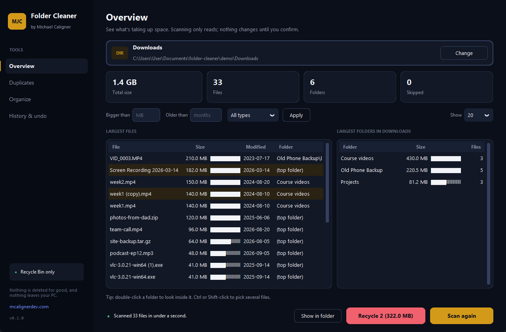
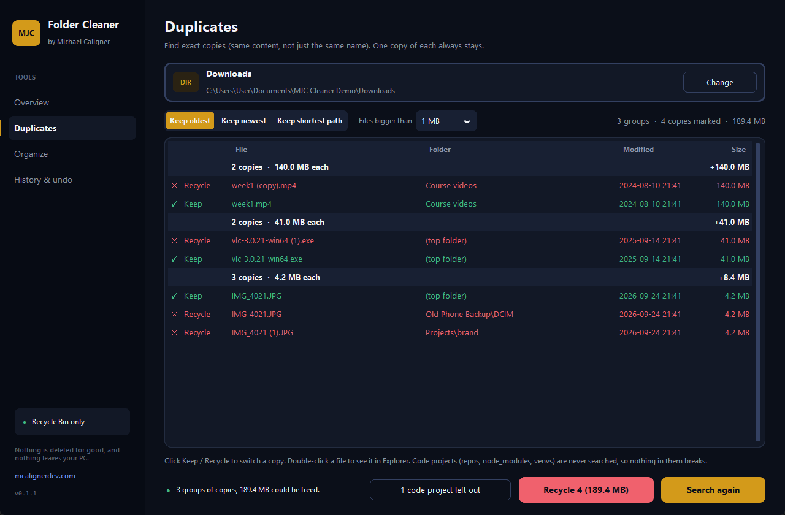
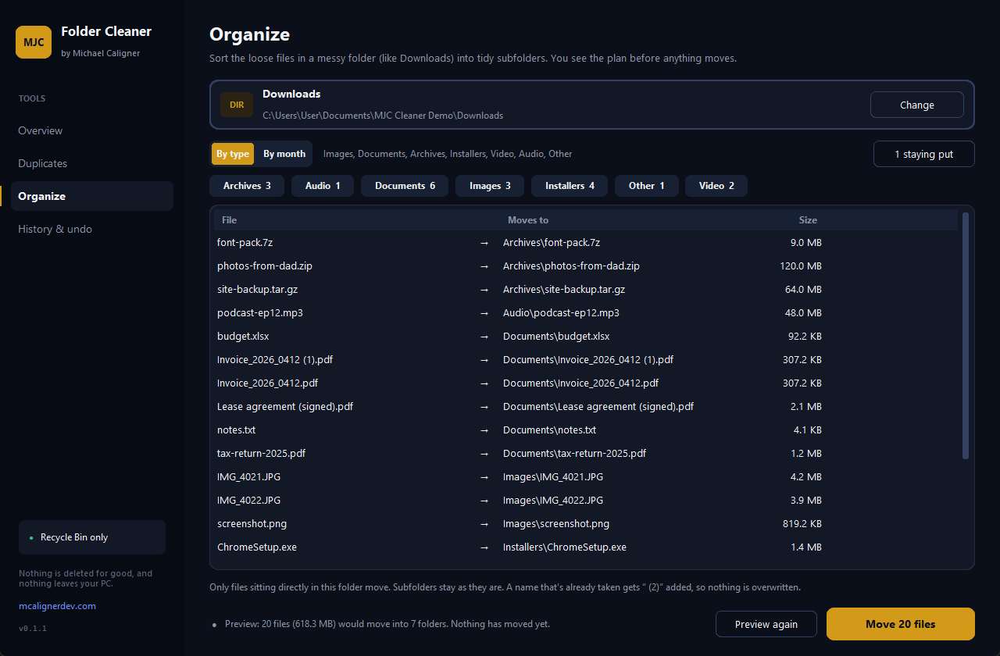

# MJC Folder Cleaner

[](https://github.com/cals101417/folder-cleaner/actions/workflows/tests.yml)

A small, offline Windows app that shows **what's taking up space**, finds **duplicate files**, and **tidies messy folders** like Downloads. It never deletes anything for good: every delete goes to the Recycle Bin, and every move can be undone.

Built by [Michael Caligner](https://mcalignerdev.com). It's a sibling to MJC PDF Kit.



## Download

**[Download the latest `MJC Folder Cleaner.exe`](https://github.com/cals101417/folder-cleaner/releases/latest)** from GitHub Releases. It's one file with no installer. Windows 10 or 11.

The `.exe` isn't code-signed yet, so Windows SmartScreen may say "Windows protected your PC". Click **More info**, then **Run anyway**.

## What it does

| Screen | What you get |
|---|---|
| **Overview** | Pick or drop a folder and scan it, with live progress and a Cancel button. See the total size, the largest files and the largest subfolders, each with a size bar. Double-click a folder to look inside it. Filter by **bigger than X MB**, **older than N months** and **file type**, then send the files you pick to the Recycle Bin. |
| **Duplicates** | Finds exact copies (same bytes, not just the same name). Choose **keep oldest**, **keep newest** or **keep shortest path**, and the other copies are pre-selected. Click any copy to switch it between Keep and Recycle. The app won't let you recycle every copy in a group. |
| **Organize** | Sorts the loose files in a folder into `Images`, `Documents`, `Archives`, `Installers`, `Video`, `Audio` and `Other`, or into one folder per month (`2026-10`). You always see the full plan first. Name clashes become `photo (2).jpg`, so nothing is overwritten. Downloads that are still in progress are left alone. |
| **History & undo** | Every batch the app ran, with each file it touched. **Undo** moves an organize batch back. For recycled files, it points you to the Recycle Bin's own **Restore**. |





## Safety first

This app touches your files, so these rules are enforced in code and covered by tests:

- **Nothing is permanently deleted.** Deletes go through [Send2Trash](https://github.com/arsenetar/send2trash) to the Recycle Bin. There's no `os.remove`, `os.unlink` or `shutil.rmtree` anywhere in `app/core/`, and a test greps the code to keep it that way.
- **No silent permanent deletes.** Windows quietly deletes a file outright, with no Recycle Bin copy, when it's on a drive without a bin (USB stick, network share), when the bin is turned off, or when the file is bigger than the bin. The app checks all three before each delete and leaves those files alone.
- **Never follows shortcuts out of the folder.** Symlinks and junctions are skipped while scanning, so the app can't loop forever or wander onto another drive.
- **System folders are off-limits.** It refuses `C:\Windows`, `Program Files`, `ProgramData`, `AppData`, drive roots and your user folder itself (pick a folder inside it). You can't override this.
- **Stale files are skipped.** Right before recycling or moving a file, the app checks that it still has the same size and modified time as when it was scanned. If it changed, it's skipped and listed.
- **You confirm every batch.** A dialog shows how many files and how much space before anything happens.
- **One bad file never stops the job.** Locked or unreadable files are counted and listed, not crashed on.
- **Cloud files stay in the cloud.** OneDrive "online-only" placeholders aren't read during the duplicate search, so nothing gets downloaded.

## Why I built this

Disk-cleaner tools tend to fall into two camps: tiny scripts that delete files with no way back, and big "PC optimizer" suites that want an account, run in the background and poke at the registry. I wanted something in between: one small `.exe` that shows where the space went, finds real duplicates, sorts a Downloads folder, and can't lose a file. Every delete goes to the Recycle Bin and every move can be undone.

It's also a portfolio piece. The core logic in `app/core/` has no UI code and is fully tested, the UI never freezes (even on 100,000 files), and the safety rules above are written down as tests rather than promises.

## Run from source

1. Install [Python 3.12](https://www.python.org/downloads/) and tick **Add python.exe to PATH**.
2. Double-click **`run.bat`**. The first run creates a `.venv` and installs the dependencies.

## Build the .exe

Double-click **`build.bat`**. It installs everything, runs the tests, then builds `dist\MJC Folder Cleaner.exe` with PyInstaller (one file, about 20 MB).

## Tests

```
pip install -r requirements.txt pytest
python -m pytest -q
```

The tests cover scanning (junctions, symlinks, unreadable folders, cancel), size totals and filters, duplicate detection (including files with the same size but different content, and files that only differ after the first 64 KB), keep-at-least-one-copy, organize planning with name clashes, protected-path refusal, the stale-file skip, undo of moves, the Recycle Bin checks, and the "no permanent delete in core" grep. CI runs them on `windows-latest`.

## Performance

Measured on a Windows 11 PC with an NVMe SSD and 100,000 small files:

| Job | Time |
|---|---|
| Scan | 0.4 s |
| Size tree | 0.15 s |
| Duplicate search (worst case: every file has a same-size partner) | 6.6 s |
| Cancel, from click to stopped | under 0.2 s |

All of it runs on a background thread, so the window stays responsive.

## Stack

- **Python 3.12** with **CustomTkinter** (UI) and **tkinterdnd2** (drag a folder onto the window)
- **Send2Trash** for every delete (Recycle Bin only)
- **hashlib BLAKE2b** for duplicate detection (standard library, no extra dependency)
- **pytest**, and **PyInstaller** for the one-file `.exe`

Every dependency is permissively licensed (MIT, BSD, Apache-2.0, CC0 or MIT-CMU). Nothing is AGPL or GPL.

## Project layout

```
app/
  config.py          name, version, links  ← rebrand here
  settings.py        remembers the last folder and choices (%APPDATA%\MJC Folder Cleaner\settings.json)
  core/              no UI code, ever
    scan.py          walk a folder → file records; never follows links
    sizes.py         folder size tree, largest files and folders
    dupes.py         size → first 64 KB → full hash; keep policies
    organize.py      dry-run plan and apply for sort by type or month
    actions.py       recycle, move, undo; JSON journal; Recycle Bin checks
    rules.py         protected paths, file types, filters
    errors.py        user-facing error messages
  ui/
    theme.py         colors and fonts (mcalignerdev.com palette)
    widgets.py       buttons, folder picker, tables, dialogs
    worker.py        runs jobs off the UI thread; widgets only via worker.post
    window.py        sidebar and navigation
    views/           overview, duplicates, organize, history
tests/
scripts/             make_icon.py, make_demo.py (demo folder), screenshots.py (UI smoke run)
okf/                 project notes: architecture, safety, decisions, log
```

## Roadmap

Not in v0.1. Ideas for later:

- Similar-image and fuzzy matching (resized photos, near-duplicate videos)
- Cloud drives (OneDrive, Google Drive, Dropbox) as first-class sources
- Scheduled cleaning
- System cleaning: temp files, caches, the registry
- macOS and Linux packaging
- Code signing for the `.exe`

## License

[MIT](LICENSE) © Michael Caligner
